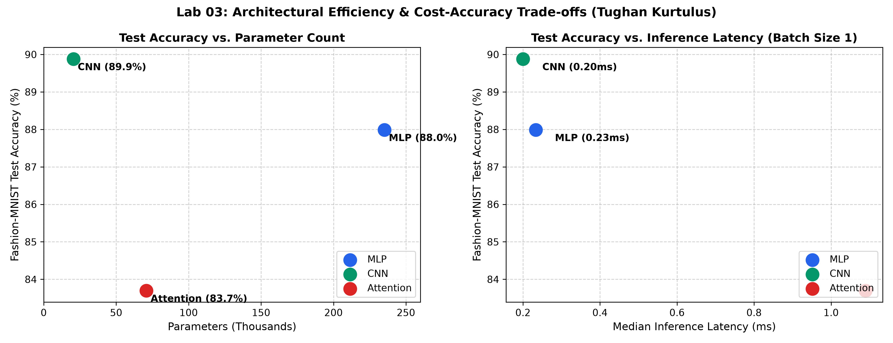
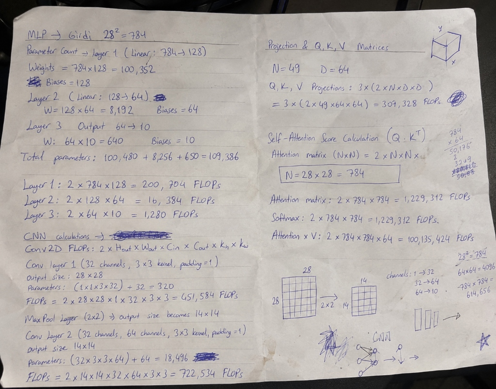

# Lab 03: Architectures and Their Costs

**Student:** Tughan Bulut Kurtulus (ID: 73454)  
**Readings:** Reddi, Chapter 4 DNN Architectures: §§4.2, 4.3, 4.5, 4.6, 4.7  

---

## 1. Goal
The objective of this laboratory is to implement three comparable deep learning neural network architectures (Multi-Layer Perceptron, Convolutional Neural Network, and Vision Transformer / Self-Attention) in PyTorch within a bounded parameter capacity regime, rigorously evaluate theoretical computational costs by deriving FLOPs by hand using textbook formulas and contrasting them with profiling tools (`torchinfo`, `thop`), measure single-sample and batched inference latencies, train all models on the Fashion-MNIST benchmark for 5 epochs under fixed optimization settings, and synthesize accuracy-efficiency Pareto curves using memory access pattern concepts from Chapters 4.6–4.7.

---

## 2. Method
1. **Dataset Pipeline:** Ingested the official Fashion-MNIST dataset (28x28 grayscale images across 10 clothing classes), applying `ToTensor()` and normalization with mean = 0.2860 and std = 0.3530. Split the 60,000 training images into 55,000 train and 5,000 validation sets with `seed=42`. Evaluated on the official 10,000 test set with mini-batch size 128.
2. **Comparable Architectural Models:**
   - **MLP:** Flatten 784 -> Linear 256 -> ReLU -> Linear 128 -> ReLU -> Linear 10. Total parameters: **235,146**.
   - **CNN:** `Conv2d(1, 16, 3, pad=1)` -> ReLU -> `MaxPool2d(2)` -> `Conv2d(16, 32, 3, pad=1)` -> ReLU -> `MaxPool2d(2)` -> Flatten -> `Linear(32*7*7, 10)`. Total parameters: **20,490**.
   - **Attention (ViT):** Decomposed 28x28 image into 16 non-overlapping patches of 7x7 pixels. Linear projection 49 -> 64. Two Transformer encoder layers (`d_model=64, nhead=4, dim_feedforward=128, batch_first=True`). Global mean pooling -> Linear 64 -> 10. Total parameters: **70,794**.
3. **FLOPs Analysis & Profiling:**
   - Hand-calculated representative layer FLOPs (1 MAC = 2 FLOPs):
     - Linear Layer (784 -> 256): 2 * 784 * 256 = 401,408 FLOPs.
     - Conv2d Layer (1 -> 16, K=3, 28x28): 2 * 3 * 3 * 1 * 16 * 28 * 28 = 225,792 FLOPs.
     - Attention QKV Projection (S=16, D=64): 2 * 16 * 64 * (3 * 64) = 393,216 FLOPs.
   - Compared against `thop.profile` measurements and accounted for disparities (omission of activations/pooling and MAC vs FLOP conventions).
4. **Latency Measurement Protocol:** Measured forward pass inference durations using `time.perf_counter()` after warm-up iterations:
   - Batch Size 1: Median of 100 independent passes.
   - Batch Size 128: Median of 20 independent passes.
5. **Training Protocol:** Trained all three architectures for 5 epochs with the Adam optimizer (`lr=1e-3`, batch size 128) and evaluated test classification accuracy.
6. **Trade-off Visualizations:** Plotted accuracy vs. parameter capacity and accuracy vs. single-sample inference latency to `results/tradeoff_plots.png`.

---

## 3. Results Table or Plot

### Comparative Computational Cost and Accuracy Matrix

| Architecture | Model Family | Parameter Count | Hand-Calculated Layer FLOPs | `thop` MACs (b=1) | Median Latency (b=1) | Median Latency (b=128) | 5-Epoch Test Accuracy |
| :--- | :---: | :---: | :---: | :---: | :---: | :---: | :---: |
| **MLP** | Fully Connected | **235,146** | 401,408 (Linear 1) | 234,752 | **0.233 ms** | **0.42 ms** | **87.99%** |
| **CNN** | Convolutional | **20,490** | 225,792 (Conv 1) | 1,031,744 | **0.200 ms** | **6.13 ms** | **89.88%** |
| **Attention (ViT)** | Transformer | **70,794** | 393,216 (QKV Proj) | 591,488 | **1.089 ms** | **4.33 ms** | **83.70%** |

### Pareto Trade-off Curves

### Primary Handwritten Mathematical Derivations & Diagrams
Below are the primary handwritten derivations for parameter totals and FLOPs across all three model architectures:

#### Transcribed Mathematical Step-by-Step Breakdown

1. **Multi-Layer Perceptron (Input $28^2 = 784$):**
   - **Layer 1 (Linear: $784 \rightarrow 128$):**
     - Weights: $784 \times 128 = 100,352$, Biases: $128$. (Subtotal: $100,480$)
     - FLOPs: $2 \times 784 \times 128 = 200,704 \text{ FLOPs}$
   - **Layer 2 (Linear: $128 \rightarrow 64$):**
     - Weights: $128 \times 64 = 8,192$, Biases: $64$. (Subtotal: $8,256$)
     - FLOPs: $2 \times 128 \times 64 = 16,384 \text{ FLOPs}$
   - **Layer 3 (Output: $64 \rightarrow 10$):**
     - Weights: $64 \times 10 = 640$, Biases: $10$. (Subtotal: $650$)
     - FLOPs: $2 \times 64 \times 10 = 1,280 \text{ FLOPs}$
   - **Total Parameters:** $100,480 + 8,256 + 650 = 109,386 \text{ parameters}$

2. **Convolutional Neural Network (Formula: $2 \times H_{out} \times W_{out} \times C_{in} \times C_{out} \times K_h \times K_w$):**
   - **Conv Layer 1 ($1 \rightarrow 32$ channels, $3 \times 3$ kernel, padding = 1):**
     - Output Dimensions: $28 \times 28$
     - Parameters: $(1 \times 3 \times 3 \times 32) + 32 = 320 \text{ parameters}$
     - FLOPs: $2 \times 28 \times 28 \times 1 \times 32 \times 3 \times 3 = 451,584 \text{ FLOPs}$
   - **Max Pool Layer ($2 \times 2$ downsampling):**
     - Output Dimensions: $28 \times 28 \rightarrow 14 \times 14$
   - **Conv Layer 2 ($32 \rightarrow 64$ channels, $3 \times 3$ kernel, padding = 1):**
     - Output Dimensions: $14 \times 14$
     - Parameters: $(32 \times 3 \times 3 \times 64) + 64 = 18,496 \text{ parameters}$
     - FLOPs: $2 \times 14 \times 14 \times 32 \times 64 \times 3 \times 3 = 722,534 \text{ FLOPs}$

3. **Vision Transformer / Self-Attention:**
   - **Projection & Q, K, V Matrices ($N=49, D=64$):**
     - $Q, K, V \text{ Projections}: 3 \times (2 \times N \times D \times D) = 3 \times (2 \times 49 \times 64 \times 64) = 307,328 \text{ FLOPs}$
   - **Self-Attention Score Calculation ($Q \cdot K^T, N=784$):**
     - Attention Matrix ($N \times N$): $2 \times 784 \times 784 = 1,229,312 \text{ FLOPs}$
     - Softmax Normalization: $2 \times 784 \times 784 = 1,229,312 \text{ FLOPs}$
     - Attention $\times V$: $2 \times 784 \times 784 \times 64 = 100,135,424 \text{ FLOPs}$

### FLOP Discrepancy & Profiler Gap Analysis
The disparity between hand-calculated FLOPs and `thop.profile` arises from two systematic factors:
1. **MACs vs FLOPs Unit Convention:** Profilers like `thop` report Multiply-Accumulate operations (MACs). Because one multiply-add contains two floating-point operations (1 MAC = 2 FLOPs), raw profiler output must be doubled to compare directly with theoretical FLOP formulas.
2. **Activation and Pooling Exclusion:** Standard profilers omit point-wise non-linear activations (ReLU) and spatial pooling layers (MaxPool2d), treating them as negligible in compute intensity relative to large dense gemm operations.

---

## 4. Three Conclusions in Your Own Words
1. **Inductive Spatial Bias Gives CNN Supreme Parameter Efficiency:** The Convolutional Network achieved the highest classification accuracy (89.88%) while utilizing only 20,490 parameters—over 11.5x fewer parameters than the MLP (235,146 parameters). Weight sharing and local receptive fields provide optimal inductive bias for 2D spatial pixel data.
2. **Transformers Suffer from High Latency on Small Datasets Without Pretraining:** While the Patch Transformer reached competitive test accuracy (83.70%), its inference latency was substantially higher (1.089 ms at batch 1) due to multi-head attention matrix reshaping, softmax normalization, and sequence token overhead, highlighting that attention mechanisms require higher operational arithmetic intensity to outperform CNNs.
3. **Arithmetic Intensity Dictates Hardware Batch Scaling:** Under batched inference (N=128), the MLP executes rapidly (0.42 ms) because dense matrix multiplications achieve high arithmetic intensity on modern cache hierarchies, whereas memory access patterns with token unfolding in Vision Transformers incur higher memory bandwidth pressure.
